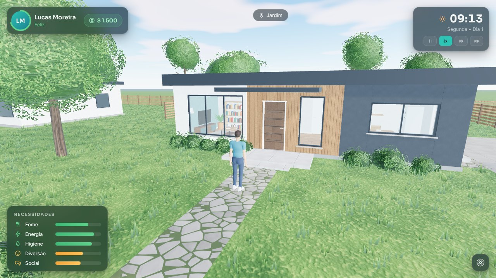
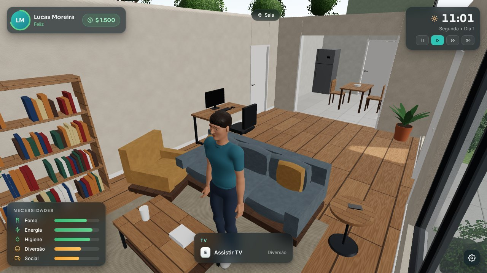
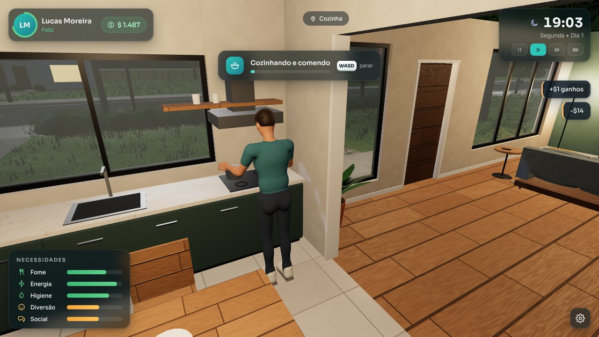
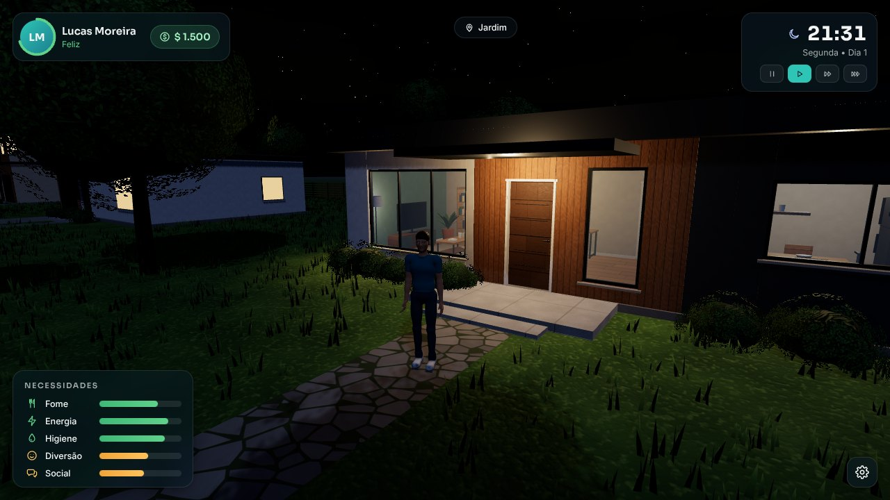

# LIFE WORLD 3D — Alpha 0.1

Simulador de vida em 3D, original, que roda no **navegador** (PC). Você controla **Lucas Moreira**, um
morador da *Rua das Acácias*: explore o bairro, entre em casa, durma, cozinhe, tome banho, trabalhe no
computador e cuide das necessidades dele enquanto o dia vira noite.



| Sala | Cozinha | Noite |
| --- | --- | --- |
|  |  |  |

> Todo o conteúdo é original e gerado por código: personagem, animações, casa, móveis, texturas,
> vegetação e interface. Não há assets de terceiros nem de outros jogos.

---

## Como executar

Requisitos: **Node.js 20+** e um navegador moderno com **WebGL 2** (Chrome, Edge, Firefox ou Safari recentes).

```bash
npm install
```

```bash
npm run dev
```

Abra **http://localhost:5173** e clique em **Jogar**. Clique na tela para travar o mouse na câmera.

Build de produção (site estático em `dist/`, funciona em qualquer hospedagem e em subpastas):

```bash
npm run build
```

```bash
npm run preview
```

### Scripts

| Comando | O que faz |
| --- | --- |
| `npm run dev` | Servidor de desenvolvimento (Vite, recarga instantânea) |
| `npm run build` | Checagem de tipos + build de produção em `dist/` |
| `npm run preview` | Serve o build de produção em http://localhost:4173 |
| `npm run typecheck` | Só a checagem de tipos do TypeScript |
| `npm test` | Testes unitários (Vitest) da simulação |
| `npm run e2e` | Testes de jogabilidade no navegador (requer o jogo rodando e Playwright) |
| `npm run screenshots` | Gera as capturas de `docs/screenshots` (requer o jogo rodando e Playwright) |
| `npm run character` | Regera o personagem `public/models/character.glb` a partir do código |

Os testes `e2e` e `screenshots` usam [Playwright](https://playwright.dev). Para rodá-los na sua máquina:

```bash
npm install --no-save playwright
```

```bash
npx playwright install chromium
```

Com `npm run dev` aberto em outro terminal, rode `npm run e2e` (ou passe outra URL, ex.: `npm run e2e -- http://localhost:4173`).

---

## Controles

| Tecla | Ação |
| --- | --- |
| **W A S D** / setas | Andar (relativo à câmera) |
| **Shift** (segurar) | Correr |
| **Mouse** | Girar a câmera (clique na tela para travar o cursor; sem trava, arraste) |
| **Roda do mouse** | Aproximar/afastar a câmera |
| **E** | Interagir / ação principal (abrir porta, dormir, comer...) |
| **F** | Ação secundária (ex.: jogar no PC, cochilar) |
| **W A S D** durante uma atividade | Parar a atividade |
| **1 / 2 / 3** | Velocidade do tempo (normal, rápido, ultra) |
| **0** ou **P** | Pausar/retomar o tempo |
| **Esc** | Menu de pausa (configurações, controles) |
| **F3** | Mostrar FPS |

---

## O que já existe (Alpha 0.1)

- **Bairro 3D**: rua com faixa de pedestres, calçadas com meio-fio, 9 lotes, 8 casas vizinhas
  modernas (1 e 2 pavimentos), árvores, arbustos, sebes, grama com vento, cercas, postes, caixas de
  correio, carros estacionados e placa da rua.
- **Casa do jogador**: sala, cozinha, quarto e banheiro com portas que abrem e fecham, janelas com
  vidro, rodapés, piso de madeira/cerâmica e móveis completos (sofá, TV, estante, poltrona,
  computador, mesa de jantar, cozinha planejada, geladeira, cama de casal, guarda-roupa, chuveiro,
  vaso e pia).
- **Personagem humano original** com esqueleto (padrão de nomes Mixamo) e 8 animações próprias:
  parado, andar, correr, sentar, digitar sentado, dormir, usar bancada e falar ao telefone. Os pés
  são apoiados no chão em todos os quadros e a cadência acompanha a velocidade real (sem "patinar").
- **Movimento e física** (Rapier): gravidade, colisão com paredes, móveis, árvores e portas,
  subida automática de degraus e meio-fio; o personagem gira para a direção do movimento.
- **Câmera em terceira pessoa** suave, com colisão (não atravessa paredes) e telhado que some ao
  entrar em casa.
- **Interação**: indicador com tecla e descrição ao chegar perto de algo; 19 objetos interativos (4 portas + 15 objetos com atividades).
- **Simulação**: relógio (1 s real = 1 min de jogo), dias da semana, 4 velocidades, ciclo de dia e
  noite completo, necessidades (fome, energia, higiene, diversão, social), humor e dinheiro.
- **Interface própria**: tela de carregamento, título, HUD, notificações, menu de pausa,
  configurações (gráficos, sensibilidade, FOV, escala da interface) e tela de controles.

A lista completa, as limitações e os próximos passos estão no
[relatório da Alpha 0.1](docs/RELATORIO-ALPHA-0.1.md). A organização do código está em
[docs/ARQUITETURA.md](docs/ARQUITETURA.md).

---

## Tecnologias

| Área | Biblioteca |
| --- | --- |
| Gráficos 3D | [Three.js](https://threejs.org) 0.187 (WebGL 2, PBR, sombras dinâmicas, céu atmosférico) |
| Física | [Rapier](https://rapier.rs) 0.19 (`@dimforge/rapier3d-compat`, Kinematic Character Controller) |
| Interface | React 19 + Zustand (estado compartilhado jogo ↔ UI) |
| Linguagem | TypeScript 5.9 (modo estrito) |
| Build | Vite 7 |
| Modelos | GLB/glTF 2.0 (gerado por `scripts/character`, carregado com `GLTFLoader`) |
| Testes | Vitest (unitários) + Playwright (jogabilidade no navegador) |
| Fontes | Sora e Inter via `@fontsource` (empacotadas, funcionam offline) |

## Estrutura de pastas

```
life-world/
├── index.html               # página do jogo
├── viewer.html              # visualizador do personagem (ferramenta de desenvolvimento)
├── public/models/character.glb
├── scripts/
│   ├── character/           # gerador procedural do personagem (SDF -> malha -> skin -> GLB)
│   └── e2e/                 # testes de jogabilidade e capturas de tela (Playwright)
├── docs/                    # arquitetura, relatório da Alpha 0.1 e capturas
└── src/
    ├── main.tsx             # entrada React
    ├── game/
    │   ├── Game.ts          # orquestrador: carregamento, loop e API de depuração
    │   ├── core/            # renderizador (Engine) e entrada (Input)
    │   ├── physics/         # mundo Rapier, grupos de colisão, consultas
    │   ├── player/          # modelo/animação, controle do personagem, câmera
    │   ├── interaction/     # contratos, sistema de foco/prompt e portas
    │   ├── sim/             # relógio, necessidades, atividades (+ testes)
    │   ├── state/           # store compartilhada e configurações
    │   └── world/           # texturas, materiais, casas, móveis, vegetação, dia/noite
    ├── ui/                  # HUD, telas, menus, ícones e estilos
    └── dev/viewer.ts        # código do visualizador do personagem
```

## Personagem: como regerar ou substituir

`npm run character` executa `scripts/character/build-character.ts`, que esculpe o corpo com funções de
distância (SDF), extrai a malha (surface nets), simplifica (meshoptimizer), calcula pesos de skin,
assa oclusão ambiente e gera as animações em keyframes, exportando `public/models/character.glb`.

Para trocar por um modelo feito em Blender/Mixamo, basta exportar um GLB humanoide com clipes chamados
`Idle`, `Walk`, `Run`, `Sit`, `SitUse`, `Sleep`, `Use` e `Phone` e salvar no mesmo caminho (ou apontar
outro arquivo com a variável `VITE_CHARACTER_URL` no build). O jogo não depende da malha atual.
`scripts/tools/glb-to-gltf.mjs` converte um `.glb` em `.gltf` (JSON com o buffer embutido), para
hospedagens que não servem arquivos `.glb`.

## Créditos

Direção de desenvolvimento: ChatGPT. Desenvolvimento técnico e visual: Claude. Código, modelos,
animações e texturas foram criados para este projeto; as bibliotecas de terceiros mantêm as próprias
licenças (MIT, Apache-2.0 e OFL para as fontes). O projeto ainda não tem uma licença definida.
