# Relatório de entrega — LIFE WORLD 3D Alpha 0.1

**Data:** 09/11/2026 · **Versão:** 0.1.0 · **Status:** primeira versão jogável concluída e testada.

Este relatório segue o "Método de trabalho" do documento de desenvolvimento: o que foi construído,
como executar, controles, pendências, problemas encontrados, estrutura e capturas.

---

## 1. O que foi construído

### Mapa — "Rua das Acácias"
- Rua asfaltada com faixa central, bordas pintadas e faixa de pedestres; calçadas de concreto com meio-fio.
- 9 lotes: a casa do jogador e 8 casas vizinhas modernas geradas por código (1 ou 2 pavimentos, garagem,
  ripado de madeira, tijolinho ou reboco colorido; janelas que acendem à noite).
- Vegetação: 40 árvores instanciadas com 3 formatos (tronco, copa e cartões de folhas recortadas),
  arbustos, sebes e grama com animação de vento.
- Mobiliário urbano: 10 postes com luz noturna, caixas de correio, cercas de madeira, 3 carros,
  placa da rua, deck e banco no quintal.
- Limites do mapa com sebes e paredes invisíveis (área jogável ≈ 156 × 75 m).

### Casa do jogador (térreo moderno, 12 × 9 m)
- **Sala** (8 × 4,5 m): sofá, TV com móvel, mesa de centro, tapete, estante com livros, poltrona de
  leitura, escrivaninha com computador e cadeira, mesa lateral com telefone, luminária de chão e plantas.
- **Cozinha** (4 × 4,5 m, integrada por vão): bancada com pia e cooktop, coifa, prateleira, geladeira,
  mesa de jantar com 2 cadeiras e porta lateral para a garagem.
- **Quarto** (8 × 4,5 m): cama de casal com criados-mudos e abajures, guarda-roupa, tapete, planta.
- **Banheiro** (4 × 4,5 m): chuveiro com box de vidro, vaso sanitário, pia com espelho, revestimento cerâmico.
- 4 portas articuladas (entrada, lateral, quarto e banheiro), 6 janelas com vidro e esquadrias,
  rodapés, forro, laje com platibanda, marquise, varanda e degraus.

### Personagem
- **Lucas Moreira**, humano original (1,77 m), gerado por `scripts/character/` e exportado em GLB:
  corpo esculpido por SDF (46 mil triângulos, mais 9 mil do cabelo), roupas (camiseta, calça, tênis), sobrancelhas,
  olhos e oclusão ambiente assada.
- Esqueleto com 22 ossos no padrão Mixamo (substituível por modelos de Blender/Mixamo).
- 8 animações próprias: `Idle`, `Walk`, `Run`, `Sit`, `SitUse`, `Sleep`, `Use` e `Phone`.
- Pés apoiados no chão em todos os quadros (cinemática direta + raycast no jogo) e cadência
  sincronizada com a velocidade.

### Movimentação, câmera e física
- WASD relativo à câmera, Shift para correr (andar 1,55 m/s, correr 4,3 m/s), aceleração suave.
- O personagem gira para a direção do movimento.
- Rapier: gravidade, colisão com paredes, móveis, árvores, carros, cercas e portas; sobe degraus e
  meio-fio automaticamente.
- Câmera em terceira pessoa com mouse (pointer lock ou arrastar), zoom, ombro, suavização e colisão;
  ao entrar em casa o telhado some para a câmera, mas continua projetando sombra.

### Interação
- Prompt contextual com teclas **E/F**, nome do objeto, ação e custo/tempo.
- 19 objetos interativos: 4 portas + TV, sofá, poltrona, estante, telefone, computador (trabalhar ou
  jogar), geladeira, fogão, pia da cozinha, 2 cadeiras, cama (dormir ou cochilar), chuveiro, vaso e pia.
- Atividades posicionam o personagem no móvel com a pose correta, mostram progresso e terminam por
  tempo, por necessidade cheia ou ao mover-se (WASD).

### Simulação
- Relógio: 1 s real = 1 min de jogo; velocidades 1×, 3× e 10×, pausa; dormir acelera o tempo (14×).
- Dias da semana e contagem de dias; avisos às 7h e às 22h.
- Ciclo de dia e noite: sol percorrendo o céu, nascer/pôr do sol, lua, estrelas, neblina,
  iluminação ambiente do próprio céu e luzes da casa, postes e janelas acendendo à noite.
- Necessidades: fome, energia, higiene, diversão e social, com decaimento por hora e alertas abaixo de 15%.
- Humor geral (anel no avatar) e dinheiro (começa com $1.500; trabalho no PC rende $28/h; comida custa).

### Interface
- Identidade visual própria (azul-petróleo, turquesa e coral; fontes Sora e Inter; ícones SVG originais).
- Tela de carregamento com progresso, tela de título, HUD (nome, humor, dinheiro, relógio e dia,
  velocidades, local atual, necessidades, prompt, atividade e notificações).
- Menu de pausa, configurações (presets, sombras, resolução, grama, FOV, sensibilidade, inverter Y,
  tamanho da interface, FPS) e tela de controles. Configurações salvas no navegador.

---

## 2. Como executar

```bash
npm install
```

```bash
npm run dev
```

Abra http://localhost:5173 e clique em **Jogar**. Detalhes, build de produção e testes estão no
[README](../README.md).

---

## 3. Controles funcionando

| Controle | Status |
| --- | --- |
| W A S D / setas — andar | ✅ testado |
| Shift — correr | ✅ testado |
| Mouse — câmera (pointer lock e arrastar) | ✅ |
| Roda — zoom | ✅ |
| E / F — interagir | ✅ testado |
| WASD — cancelar atividade | ✅ testado |
| 1/2/3 e 0/P — velocidade do tempo | ✅ |
| Esc — pausa | ✅ testado |
| F3 — FPS | ✅ |

---

## 4. Testes realizados

| Verificação | Resultado |
| --- | --- |
| `npm run typecheck` (TypeScript estrito) | ✅ sem erros |
| `npm test` — 10 testes unitários (relógio e necessidades) | ✅ 10/10 |
| `npm run e2e` — 15 testes de jogabilidade no Chromium | ✅ 15/15 (no servidor de desenvolvimento e no build de produção) |
| `npm run build` | ✅ build estático em `dist/` |

Testes de jogabilidade: personagem nasce apoiado no chão · andar desloca · correr é mais rápido · gira
para a direção do movimento · porta fechada bloqueia · prompt aparece perto da porta · E abre a porta
e permite entrar · não atravessa parede · sobe degraus e meio-fio · não atravessa móveis · geladeira
aumenta a fome e cobra $6 · dormir acelera o tempo e recupera energia · necessidades decaem · ciclo
dia/noite altera a luz · Esc pausa e congela o relógio.

**Desempenho medido (cena típica):** 185–285 draw calls e ~700 mil triângulos por quadro, somando o
passe de sombras (~237 colisores). O FPS real **não foi medido**: o ambiente de testes usa renderização
por software (sem GPU). Há presets *Desempenho/Equilibrado/Qualidade* para computadores mais simples.

---

## 5. Problemas encontrados e soluções

1. **O personagem não subia degraus nem o meio-fio.** O auto-step do Rapier só age quando o contato é
   com uma face vertical, e a base arredondada da cápsula transforma degraus baixos em "rampas".
   *Solução:* colisor cilíndrico (base plana) e teste automatizado de degraus.
2. **Pés 2–3 cm abaixo do chão** (folga do controlador). *Solução:* raycast até o chão real a cada quadro.
3. **Interiores superexpostos:** a luz ambiente do céu não é bloqueada pelas paredes. *Solução:*
   ambiente de iluminação neutro para interiores, com transição ao entrar ou sair.
4. **Grama branca e livros desbotados:** cores de vértice em sRGB tratadas como lineares. *Solução:* conversão de espaço de cor.
5. **O foco de interação pegava objetos atrás do personagem** (TV × telefone). *Solução:* pontuação
   que prioriza a direção do personagem; a câmera só ajuda a curta distância.
6. **Esc com o cursor travado nem sempre abria a pausa.** *Solução:* a pausa abre direto e o cursor é liberado.
7. **Canelas atravessando o assento ao sentar.** *Solução:* âncoras dos assentos reposicionadas.

---

## 6. Limitações e pendências (fora do escopo da Alpha 0.1)

- **Personagem:** aparência realista-estilizada; sem dedos separados, piscar ou expressões; roupa e
  cabelo fixos; sem criação de personagem.
- **Atividades:** o personagem "desliza" até o móvel (0,3 s) em vez de caminhar até ele (não há pathfinding).
- **Sem NPCs:** a necessidade social é suprida pelo telefone.
- Casas vizinhas só com exterior; a casa do jogador é térrea (sem escadas).
- Sem áudio, sem salvar/carregar, sem modo de construção/compra.
- Iluminação interna sem iluminação global real nem sombras das luzes internas.
- Vegetação com LOD simples (oculta por distância).
- Alguns navegadores não deixam travar o cursor de novo logo após o Esc; nesse caso basta clicar na tela ou arrastar.
- Sem suporte a toque/celular (foco em PC).
- Build de produção: ≈ 3,3 MB de JavaScript (≈ 1,1 MB com gzip; a física em WASM é a maior parte) + 2,1 MB do personagem (GLB sem compressão).

## 7. Próximos passos sugeridos

1. **Salvar e carregar** o jogo (estado, horário, necessidades, dinheiro, portas).
2. **Navegação até objetos** (navmesh e pathfinding), com o personagem caminhando até a atividade.
3. **Primeiro NPC vizinho** com rotina diária e conversa (social real).
4. **Áudio:** ambiente diurno e noturno, passos, portas e TV.
5. **Criação de personagem:** parâmetros do gerador (pele, cabelo, roupa, altura) e piscar/expressões.
6. **Economia e rotina:** emprego com horário, contas e compras.
7. **Desempenho:** medir FPS em GPU integrada, LOD de árvores e casas, e compressão do GLB.

---

## 8. Estrutura de arquivos

```
index.html · viewer.html · package.json · vite.config.ts · tsconfig.json
public/   favicon.svg · models/character.glb
scripts/character/   sdf.ts · surfaceNets.ts · humanoid.ts · animations.ts · build-character.ts
scripts/e2e/         smoke.mjs · screenshots.mjs · quick.mjs · shoot-viewer.mjs
src/main.tsx
src/game/            Game.ts
  core/              Engine.ts · Input.ts
  physics/           Physics.ts
  player/            CharacterModel.ts · PlayerController.ts · ThirdPersonCamera.ts
  interaction/       types.ts · InteractionSystem.ts · Door.ts
  sim/               GameClock.ts · Needs.ts · ActivitySystem.ts · activities.ts · __tests__/sim.test.ts
  state/             store.ts · settings.ts
  world/             Neighborhood.ts · DayNight.ts · textures.ts · materials.ts · geometry.ts · vegetation.ts
    house/           HouseBuilder.ts · PlayerHouse.ts · NeighborHouse.ts
    props/           furniture.ts · street.ts
src/ui/              App.tsx · icons.tsx · styles/global.css
  hud/               Hud.tsx
  screens/           LoadingScreen.tsx · TitleScreen.tsx · Logo.tsx
  menus/             PauseMenu.tsx · SettingsMenu.tsx · ControlsMenu.tsx
src/dev/viewer.ts
docs/                ARQUITETURA.md · RELATORIO-ALPHA-0.1.md · screenshots/
```

---

## 9. Capturas de tela (jogo em funcionamento)

| | |
| --- | --- |
| 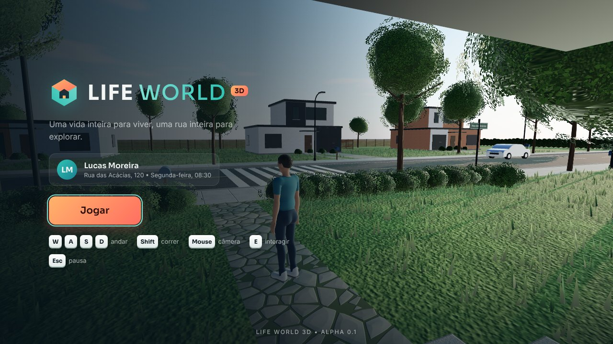 Tela de título | 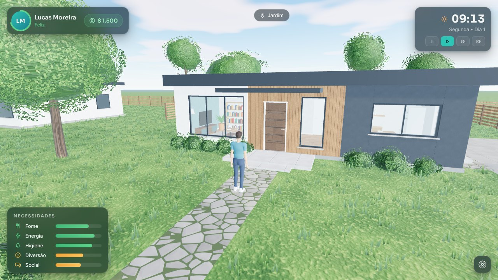 Fachada, manhã |
| 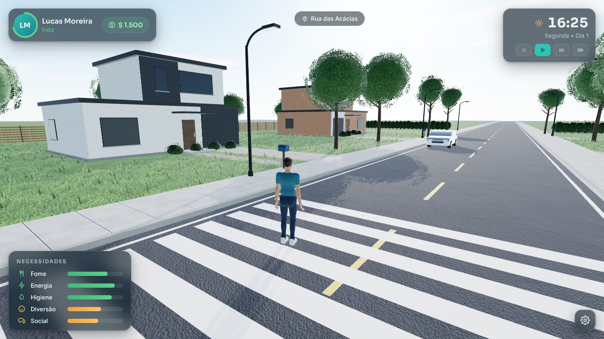 Rua das Acácias, tarde | 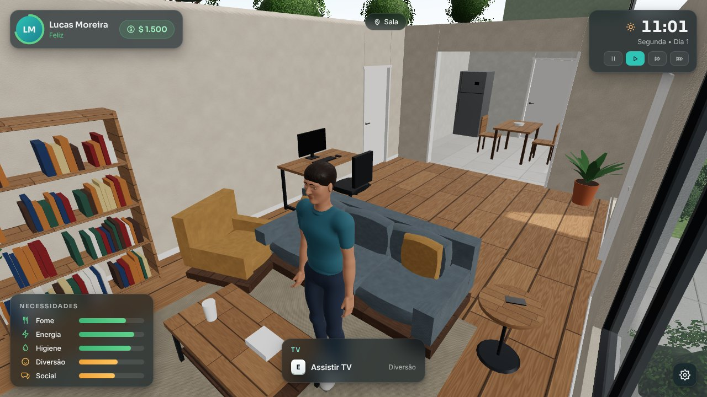 Sala com prompt de interação |
| 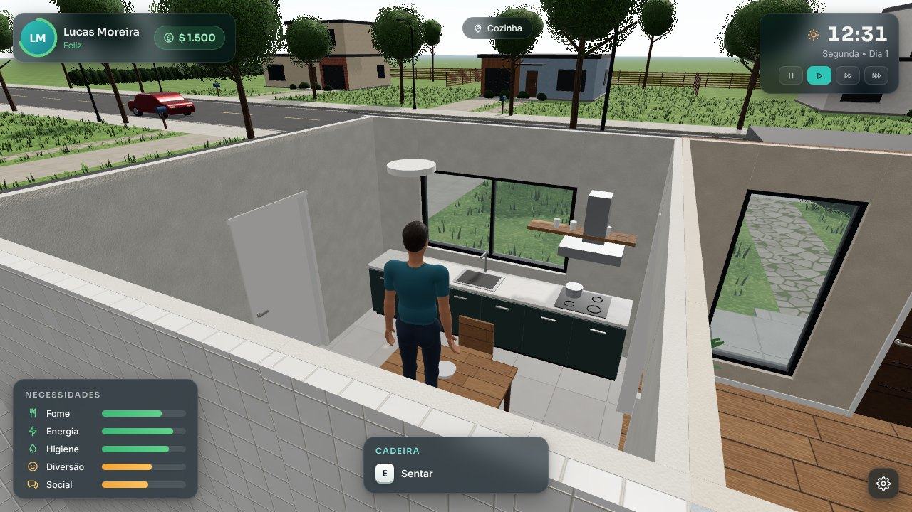 Cozinha | 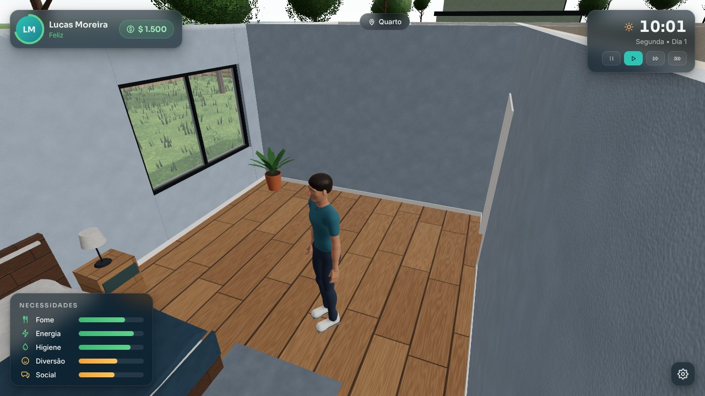 Quarto |
| 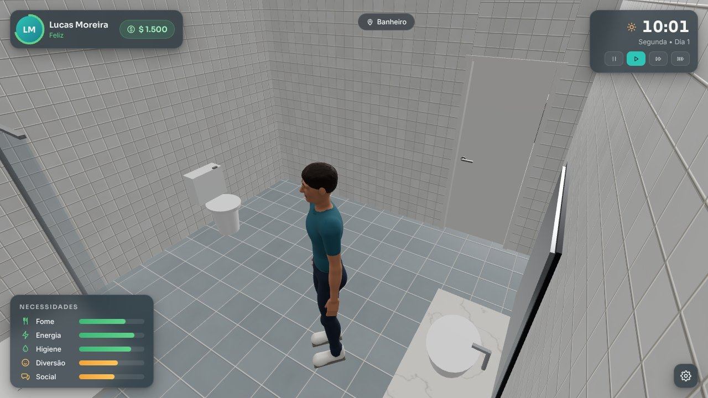 Banheiro | 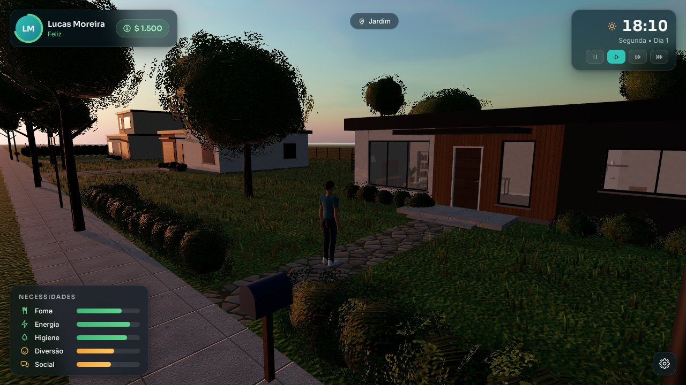 Pôr do sol |
| 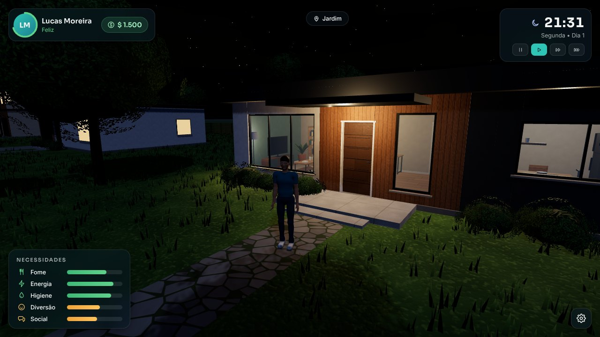 Noite com luzes acesas | 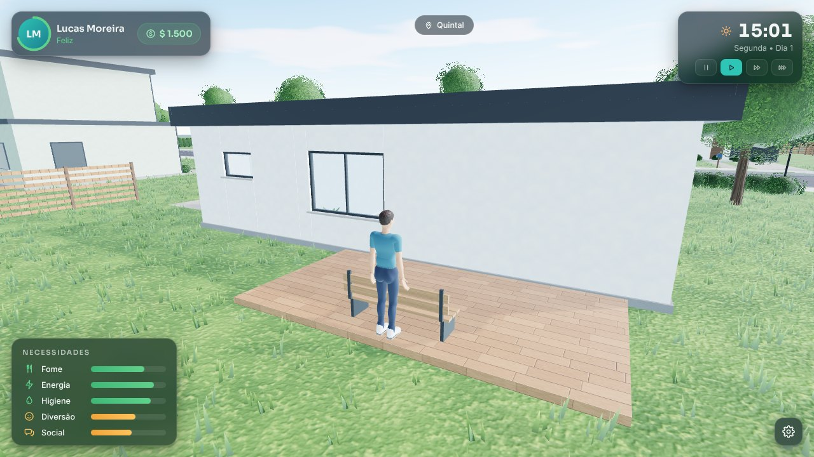 Quintal |
| 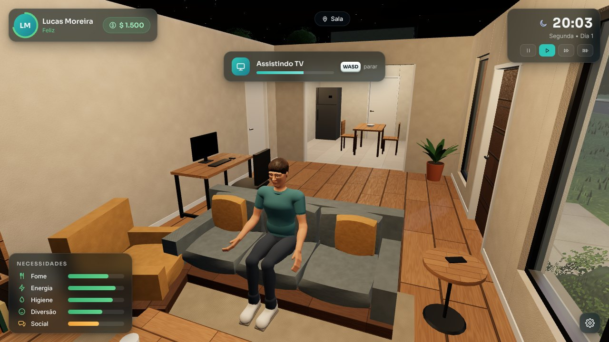 Assistindo TV (sentado) | 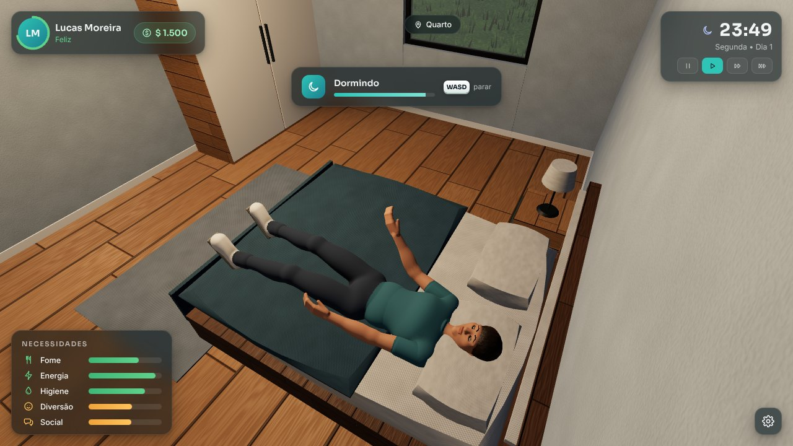 Dormindo (tempo acelerado) |
| 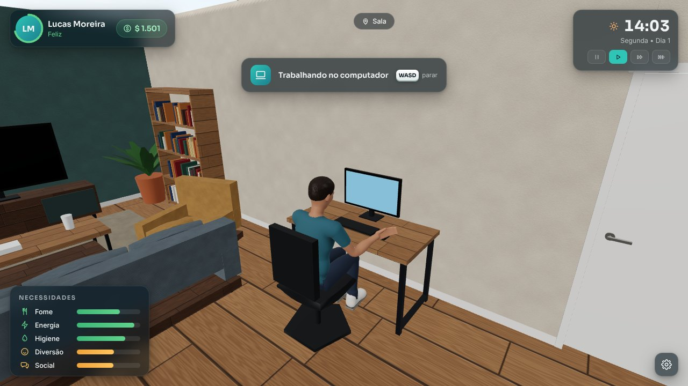 Trabalhando no computador | 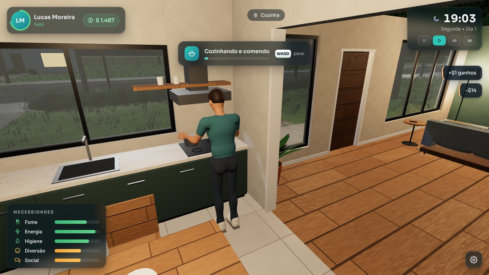 Cozinhando |
| 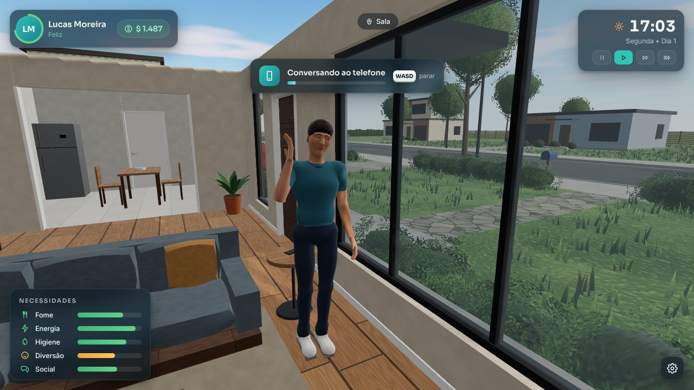 Ao telefone (social) | 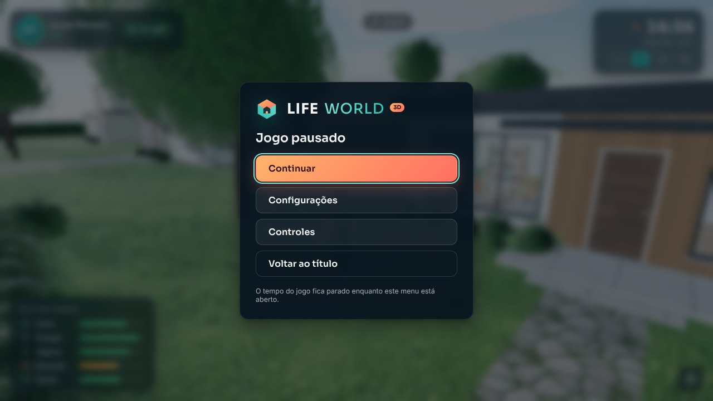 Menu de pausa |
| 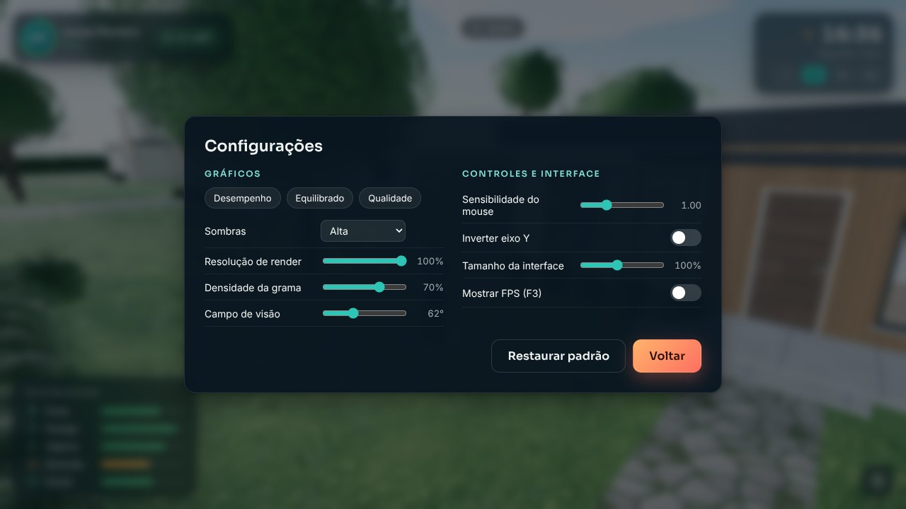 Configurações | |
